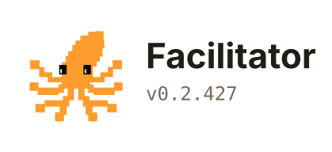
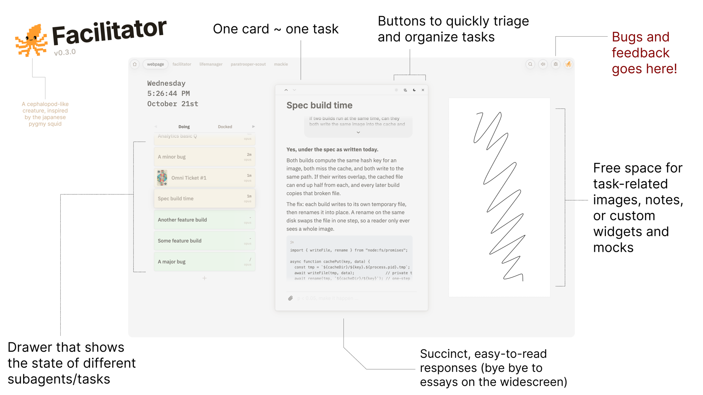
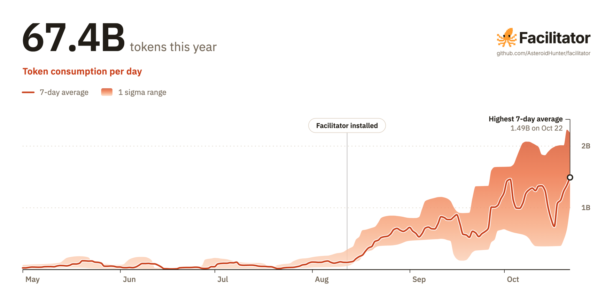

<p align="center">
  
</p>

## About 

Facilitator is an open-source alternative to the Claude Code/Codex desktop app, and it works with your existing subscriptions. 

It is an interface built to resolve *the* bottleneck when coding with agents: [understanding](https://www.geoffreylitt.com/2026/07/02/understanding-is-the-new-bottleneck). 

It does **not** have a traditional chat interface. Instead, each project on the app is linked to an orchestrator agent. To build a feature or resolve a bug, you create a card (Command + T), send a message, and the orchestrator assigns that task to a subagent in a worktree. Repeat this a bunch until you have several tasks running in the background, and you will be surprised how quickly you can iterate on a product!

The Facilitator makes it super easy to:

- **Parallelize work**. There are often feature builds or bugs that do not require a lot of discussion and can be dealt with by agents while you work on heftier tasks.
- **See which subagents/tasks are awaiting further instructions**. It is easy to lose track of several terminal windows, but color-coded UI in a box? Hard to miss.
- **Stay in the loop**. I genuinely don't think you can build anything substantive without understanding what is going on. Active cards on the Facilitator keep your mental model up-to-date. Have a doubt? Want to explore multiple approaches for a feature? Just ask!
- **Triage**. Choosing what to build later or what not to build at all is important if you want to ship! Click the moon or hit Ctrl + Shift + \ to defer a card!
- **Bonus**: after a while, all the cards and the conversations within them act as a searchable knowledge base for that project!



Facilitator is meant to complement your existing development workflow. **To make the best of the Facilitator**:
- Atomize your asks
- Learn the hotkeys
- Dispatch subagents
- Triage & ship!

## Installation

**Pre-requisites**:
- Claude Code or Codex
- Google Chrome
- macOS 11 or later

Installing the Facilitator is easy:
```
git clone https://github.com/AsteroidHunter/facilitator.git
cd facilitator
./install.sh
```

**Once installed**

1. On your favorite terminal:
`facilitator run`
2. Start a Claude or Codex session, and run `/facilitator onboard` in Claude Code and `$facilitator onboard` in Codex
3. Open a project on the facilitator, press `command + T` to open a new card, and start shipping!

### Mobile version

<p align="center">
  
</p>

The Facilitator comes with a mobile version. The mobile version is fun to use when paired with an external keyboard. 

If you have an always on machine (or like to leave your laptop running), you can access your project on the Facilitator and direct agents as long as you have **Tailscale**. 

To use the mobile version:
1. Run `facilitator bridge`
2. Scan the QR code using your phone
3. Follow the steps to set up the web app
4. Continue shipping!

## Updating the Facilitator

Facilitator is still in development and will be constantly updated. When a new version is out, the board asks whether to update; say Yes and it downloads the update, restarts if it needs to and reloads itself. To update from the terminal instead, run:
```
facilitator update
```

## Bonus

The Facilitator's home page charts how many tokens your Claude Code and Codex sessions use each day, read from their session logs on your Mac. Press the download button on the chart to save a shareable picture of your year, like this one:



## License

This project is released under the [Facilitator License 1.0.0](LICENSE.md). Contributions are accepted under the terms in [CONTRIBUTING.md](CONTRIBUTING.md).

The bundled CodeMirror editor (`app/cm-markdown.js`) is included under its own MIT license, and the bundled d3-force (`app/graph-force.js`) under its own ISC license; see [THIRD-PARTY-NOTICES.md](THIRD-PARTY-NOTICES.md).
